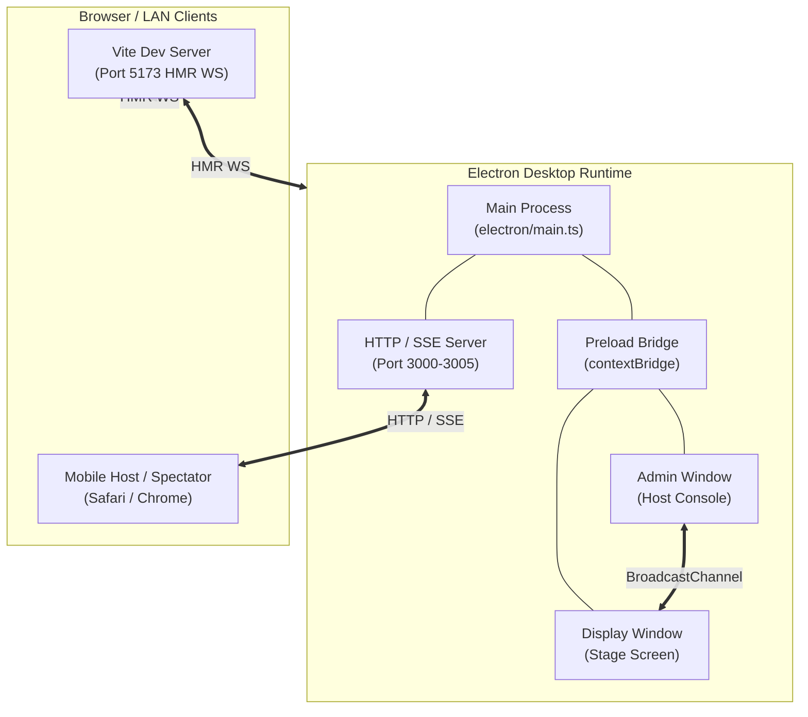
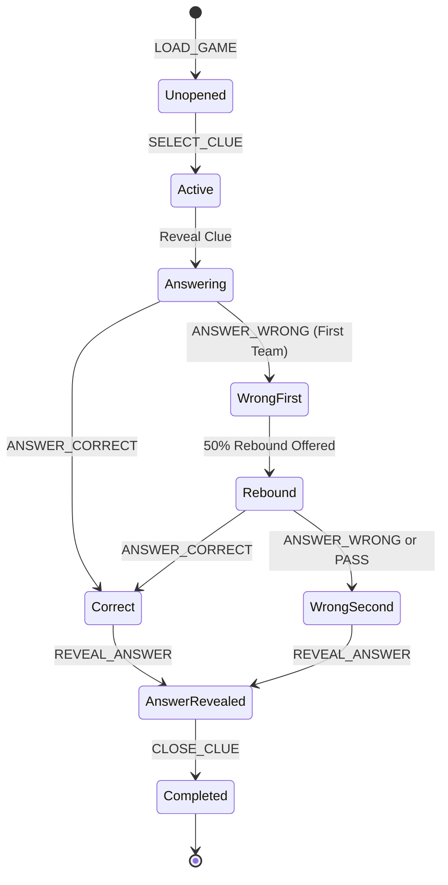

# JeoPARTY! Architecture Map

This document outlines the system architecture, state flow, synchronization
engines, media pipelines, and component boundaries of JeoPARTY!. It serves
as the architectural entry point for AI coding agents and human contributors.

---

## 1. System Topology & Runtime Boundaries

JeoPARTY! operates across two primary execution targets: an Electron desktop
shell and standalone modern browsers.



### Runtime Environments

1. **Electron Main Process (`electron/main.ts`)**:
   - Manages desktop browser windows (`adminWindow`, `displayWindow`).
   - Serves as the authoritative source of game state in desktop mode.
   - Hosts a local HTTP and Server-Sent Events (SSE) server for LAN access.
   - Registers the custom `media://` protocol for local asset playback.
   - Handles file system dialogs and `.jeoparty` archive extraction.

2. **Electron Preload (`electron/preload.ts`)**:
   - Exposes a typed, secure API (`window.electronAPI`) via `contextBridge`.
   - Bridges IPC channels: `get-game-state`, `dispatch-action`,
     `onStateUpdate`, `openGameFile`, and `saveGameFile`.

3. **React Renderer (`src/App.tsx`)**:
   - Single-Page Application (SPA) driven by Vite and Tailwind CSS.
   - Detects its display role via URL parameter `?view=admin` or
     `?view=display`.
   - Runs identically inside Electron `BrowserWindow` or browser tabs.

4. **Mobile & LAN Clients**:
   - Mobile browsers access the host or spectator views over LAN Wi-Fi.
   - Communicates with Electron via HTTP `POST /api/action` and listens for
     live state broadcasts via SSE (`GET /api/events`).

---

## 2. Core State Architecture & State Machine

Game state is maintained as an immutable data tree and mutated strictly through
a pure reducer.

### Primary State Shape (`src/types/game.ts`)

- `config`: Loaded game configuration (`GameConfig`), or `null` if unloaded.
- `currentRoundIndex`: Current active round (`0` for Jeopardy, `-1` for
  Final Jeopardy).
- `team1Score` / `team2Score`: Accumulated point totals (clamped >= 0).
- `activeClue`: Active clue session (`ActiveClueSession`), or `null`.
- `controllingTeam`: Active team (`1` or `2`) entitled to pick the next clue.
- `displayWindowOpen`: Boolean tracking whether the stage screen is open.
- `coWinnersDeclared`: Boolean indicating a declared tie game.

### Clue Lifecycle State Machine



### Final Jeopardy Lifecycle

1. **Wager Phase (`FJ_SET_WAGERS`)**: Teams lock in secret wagers up to their
   current score (or minimum threshold).
2. **Question Reveal (`FJ_REVEAL_QUESTION`)**: Question and timer are
   unveiled to contestants.
3. **Judging Phase (`FJ_JUDGE`)**: Host records correctness for both teams.
   Wagers are added or deducted from final scores.
4. **Conclusion or Reset (`FJ_RESET` / `DECLARE_CO_WINNERS`)**: Declares the
   champion or handles a tie-breaker.

---

## 3. Multi-Tier Synchronization Engine

JeoPARTY! maintains real-time synchronization across displays and devices using
four complementary communication tiers:

```
+------------------------------------------------------------------------+
|                      Multi-Tier Sync Architecture                      |
+------------------------------------------------------------------------+
| Tier 1: Electron IPC        | Main <-> Renderer via contextBridge      |
| Tier 2: BroadcastChannel    | Intra-browser tabs (jeopardy_broadcast)  |
| Tier 3: HTTP & SSE Server   | Electron <-> Mobile LAN clients          |
| Tier 4: Vite Dev WebSocket  | HMR relay for hot-reload testing         |
+------------------------------------------------------------------------+
```

### Action Deduplication & Ring Buffer

Actions dispatched across overlapping channels include an optional `_actionId`.
The `createSeenActionIdTracker` helper maintains a fixed-size ring buffer
(default 50 IDs) to discard redundant dispatches and prevent echo loops.

### Sync Flow Matrix

| Transport | Primary Use Case | State Sender | State Receiver |
| :--- | :--- | :--- | :--- |
| **Electron IPC** | Desktop Admin & Display | Main process | Preload bridge |
| **BroadcastChannel** | Multi-tab browser | Active Admin | Active Display |
| **HTTP / SSE** | Mobile phone hosting | Electron Main | Mobile browser |
| **Vite HMR WS** | Local developer testing | Vite plugin | Browser / App |

---

## 4. Media Resolution & Streaming Engine

Clues support four media types: `image`, `audio`, `video`, and `youtube`.

### Streaming Mechanisms

1. **Electron Custom Protocol (`media://`)**:
   - Electron Main registers the privileged `media://` scheme.
   - Resolves paths securely against the active extracted game directory.
   - Prevents arbitrary file system access outside the game workspace.

2. **HTTP 206 Partial Content Range Streaming**:
   - The embedded HTTP server supports `Range: bytes=start-end` headers.
   - Powers smooth scrubbing and seeking for HTML5 `<video>` and `<audio>`
     on iOS Safari and Android Chrome.

3. **External YouTube Embedding**:
   - `src/utils/youtube.ts` parses YouTube URLs and query parameters.
   - Extracts timestamps (`t=`, `start=`) and embeds via `<iframe>` using
     YouTube's privacy-enhanced domain (`youtube-nocookie.com`).

4. **Stage Sound Effects Engine (`src/utils/soundEffects.ts`)**:
   - Plays bundled MP3 cues from `public/sounds/` on `PlayerDisplay` for
     correct answers, wrong answers, and rebound steals.
   - Enforces non-repeating random track rotation and 300ms fadeout
     preemption across clue state transitions.

---

## 5. Package & Storage Architecture

JeoPARTY! stores game packages as standard ZIP files with a `.jeoparty`
extension.

### Archive Layout

```
game.jeoparty
|-- game.yaml               # Game schema, categories, clues, questions
`-- media/                  # Bundled media files
    |-- clue_1_image.jpg
    |-- clue_2_audio.mp3
    `-- clue_3_video.mp4
```

### Schema & Serialization (`src/utils/gameYaml.ts`)

- Game files are serialized as human-readable YAML.
- Runtime state (`activeClue`, scores, completed states) is stripped upon
  export to guarantee clean templates.
- Point progression arrays support arbitrary sequences and zero-value rounds.

---

## 6. Component Responsibility Matrix

- **`electron/main.ts`** (`Main Process`):
  Window management, HTTP/SSE server, IPC handlers, and `media://` protocol.
- **`electron/archive.ts`** (`Archive Engine`):
  ZIP packaging, extraction, and temp directory management for `.jeoparty`.
- **`src/views/AdminHost.tsx`** (`AdminHost`):
  Host controller, clue preview, score overrides, and Final Jeopardy wagers.
- **`src/views/PlayerDisplay.tsx`** (`PlayerDisplay`):
  Stage display, spectator board, buzzer alerts, and win celebrations.
- **`src/components/builder/GameBuilder.tsx`** (`GameBuilder`):
  Interactive game creator, category editor, and YAML/ZIP import/export.
- **`src/components/common/MediaRenderer.tsx`** (`MediaRenderer`):
  HTML5 video, audio waveforms, and responsive YouTube iframe embeds.
- **`src/hooks/useGameState.ts`** (`useGameState`):
  Multi-runtime sync orchestration, action dispatch, and SSE subscriptions.
- **`src/utils/gameReducer.ts`** (`gameReducer`):
  Pure state transition engine and game logic.
- **`src/utils/gameRules.ts`** (`Game Rules`):
  Point calculations, rebound penalty mechanics, and score floor rules.
- **`src/utils/soundEffects.ts`** (`SoundEffectsManager`):
  Stage audio cue playback, anti-repetition rotation, and fade preemption.

---

## 7. Project Invariants & Extension Guidelines

Contributors and AI agents modifying JeoPARTY! must uphold these invariants:

1. **Visual Appearance Invariant**:
   - Maintain the signature sapphire-blue boards (`#060CE9` palette) and
     golden typography (`#FFCC00`).
   - Do not alter visual layouts, fonts, or animations without explicit
     user consent.

2. **Formatting & Line Length Limit**:
   - All committed files (TypeScript, JavaScript, CSS, YAML, Markdown)
     must wrap at **<= 80 columns**.

3. **Pure State Transitions**:
   - All gameplay logic belongs inside `src/utils/gameReducer.ts`.
   - Never mutate state directly or introduce side effects into the reducer.

4. **Mandatory Test Coverage**:
   - Any new state action or gameplay mechanic requires unit tests in
     `tests/gameRules.test.ts` and end-to-end simulation tests in
     `tests/simulation.test.ts`.
   - Tests must assert on observable state transitions, never log output.
